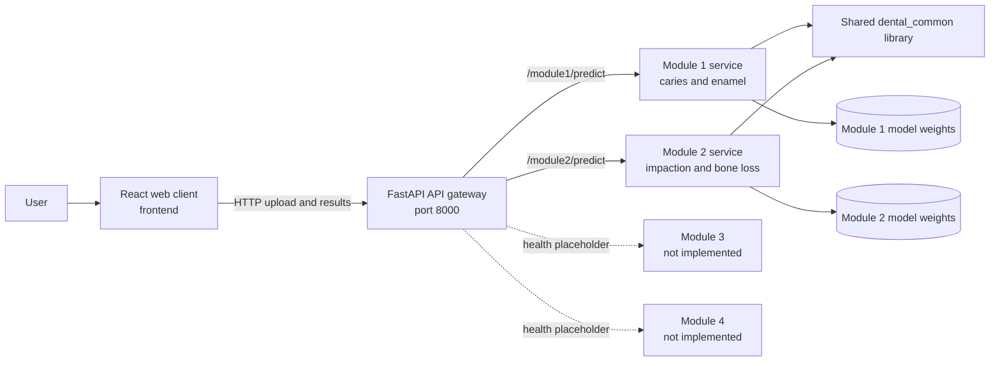

# Dental Image Analysis Platform

A research prototype for AI-assisted analysis of dental images. The project is organized as four disease-analysis components behind a web interface and API gateway. Each implemented service accepts an image, runs its configured inference pipeline, and returns structured findings for review.

> **Research use only.** This software is not a medical device and its output is not a diagnosis. Results require review by a qualified dental professional. Model availability and performance depend on the trained weights and data installed locally.

## Project at a glance

- **Web client:** React interface for selecting an analysis workflow, uploading an image, and viewing findings and annotations.
- **API gateway:** FastAPI routing layer that exposes module-specific endpoints and proxies requests to services.
- **Analysis services:** Independent Python/FastAPI services, with shared image and schema utilities.
- **Model development:** Training, evaluation, and export code lives alongside the relevant service.

## The four analysis components

| Component | Intended analysis | Current implementation |
|---|---|---|
| **1. Caries and enamel erosion** | Detect teeth and classify caries severity; estimate enamel erosion from clinical images. | Implemented inference API (`module1-caries-enamel`). Model weights are loaded from its `models_store`; supported model files and input preprocessing are described in the [Module 1 guide](services/module1-caries-enamel/README.md). |
| **2. Third-molar impaction and alveolar bone loss** | Detect teeth, identify third molars, classify angulation, and estimate bone loss from panoramic X-rays. | Implemented inference API and training pipeline (`module2-impaction-boneloss`). See the [Module 2 methodology](docs/module2_methodology.md) and service source. |
| **3. Tooth decay and root fracture** | Intended to support decay review and possible root-fracture region detection. | Placeholder only. The gateway health route reports `not_implemented`; no analysis endpoint is available. |
| **4. Gingivitis and tooth discoloration** | Intended to classify gingival appearance and tooth discoloration from intraoral images. | Placeholder only. The gateway health route reports `not_implemented`; no analysis endpoint is available. |

The component names describe the system scope, not a claim that all four models are ready. At present, the main runnable analysis workflows are Modules 1 and 2.

## System architecture



### Request flow

1. A user chooses an analysis workflow and uploads an image in the React client.
2. The client sends the image as multipart form data, with an optional pixel-spacing value, to the selected module route.
3. The gateway proxies the request to the corresponding service. Module 1 and Module 2 preprocess images and run the available models; model weights are loaded from each service's `models_store` directory.
4. The service returns structured JSON findings, model status, and (where provided) image annotations or measurements. The client presents the response for review.

The repository also contains a modality-routing helper and a unified-report route focused on Module 2. They are not a general dispatcher that currently fans a single upload out to all four components.

## Technology

- **Frontend:** React 18, Vite, React Router, and React Konva
- **API and inference:** Python, FastAPI, Uvicorn, Pydantic, and HTTPX
- **Machine learning and image processing:** TensorFlow/Keras, PyTorch/Torchvision, OpenCV, NumPy, and pydicom
- **Local orchestration:** Docker Compose
- **Shared code:** `shared-lib/dental_common` for common schemas, image I/O, metrics, and Grad-CAM utilities

## Getting started

### Run the Module 2 demo with Docker Compose

The maintained module-specific Compose file runs the Module 2 service and the frontend. From the repository root, with Docker Desktop running:

```powershell
docker compose -f docker-compose.module2-only.yml up --build
```

Open the frontend at [http://localhost:3000](http://localhost:3000). The Module 2 API is available at [http://localhost:8002](http://localhost:8002), with interactive documentation at [http://localhost:8002/docs](http://localhost:8002/docs).

The service can return heuristic fallback results when trained model weights are unavailable. A successful response therefore does not by itself indicate that trained weights were loaded; inspect `/health` and the response's `model_status` fields.

### Start services locally

Install root Python dependencies and frontend packages:

```powershell
python -m venv .venv
.\.venv\Scripts\Activate.ps1
pip install -r requirements.txt
cd frontend
npm install
```

Start the Module 2 API from its service directory:

```powershell
cd ..\services\module2-impaction-boneloss
$env:PYTHONPATH = (Get-Location).Path
uvicorn app.main:app --host 0.0.0.0 --port 8002 --reload
```

In another terminal, start the frontend:

```powershell
cd frontend
npm run dev
```

For Module 1, follow its [service guide](services/module1-caries-enamel/README.md) and start its API on port `8001`. The frontend can call module services directly by default; to route through the gateway, set `VITE_USE_GATEWAY=true`, configure `VITE_API_BASE_URL` to the gateway URL, and set `MODULE1_URL` / `MODULE2_URL` for the gateway's service addresses.

## API overview

When the gateway and the relevant service are running:

| Method | Route | Purpose |
|---|---|---|
| `GET` | `/health` | Gateway health |
| `POST` | `/module1/predict` | Proxy image analysis to Module 1 |
| `GET` | `/module1/health` | Module 1 service and model status |
| `POST` | `/module2/predict` | Proxy panoramic X-ray analysis to Module 2 |
| `GET` | `/module2/health` | Module 2 service and model status |
| `GET` | `/module3/health` | Placeholder status (`not_implemented`) |
| `GET` | `/module4/health` | Placeholder status (`not_implemented`) |
| `POST` | `/report/module2` | Module 2 report wrapper |

Both implemented services also expose `/predict`, `/health`, and `/docs` on their own service ports (`8001` and `8002`). Prediction requests use multipart form fields `file` and optional `pixel_spacing_mm`.

## Repository layout

```text
api-gateway/                         FastAPI gateway and module routes
docs/                                Project and model methodology notes
frontend/                            React client
infra/                               Nginx and PostgreSQL initialization assets
scripts/                             Module 2 setup, start, and request helpers
services/
  module1-caries-enamel/             Module 1 API, inference, training, and guide
  module2-impaction-boneloss/        Module 2 API, inference, training, and data
  module3-decay-fracture/            Module 3 placeholder
  module4-gingivitis-stain/          Module 4 placeholder
shared-lib/dental_common/             Shared schemas and image utilities
docker-compose.yml                   Local multi-container configuration
docker-compose.module2-only.yml      Module 2 and frontend demo
docker-compose.train.yml              Training configuration
```

## Model training and data

Training scripts, configuration, and dataset notes are located under each service's `training/` directory. Module 1 documents a quick bootstrap and full training workflow in its [README](services/module1-caries-enamel/README.md); Module 2 includes scripts for detection, angulation, bone-landmark segmentation, evaluation, and export. Add only data you are authorized to use, follow the service dataset format, and evaluate trained weights on held-out data before interpreting results.

Model weight files are not guaranteed to be included in a checkout. Place exported weights in the service's configured `models_store` directory and check the service health response to confirm which models loaded.

## Development notes

- `docker-compose.yml` is an early multi-container configuration and currently defines Module 2, the gateway, frontend, and PostgreSQL; it does not start all four analysis services.
- The gateway includes `/module1` and `/module2` prediction proxies. Module 3 and Module 4 currently expose health placeholders only.
- The frontend includes account screens, but this repository does not currently provide a complete account/authentication backend.
- PostgreSQL initialization assets are present; the current prediction routes do not persist analysis results to the database.

## License and clinical use

No license is specified in this repository. Contact the project maintainers for permission before redistribution or reuse. This research prototype is not validated for clinical decision-making and must not replace professional judgment.
